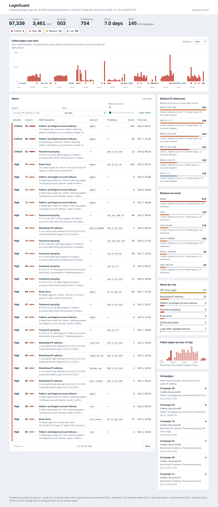
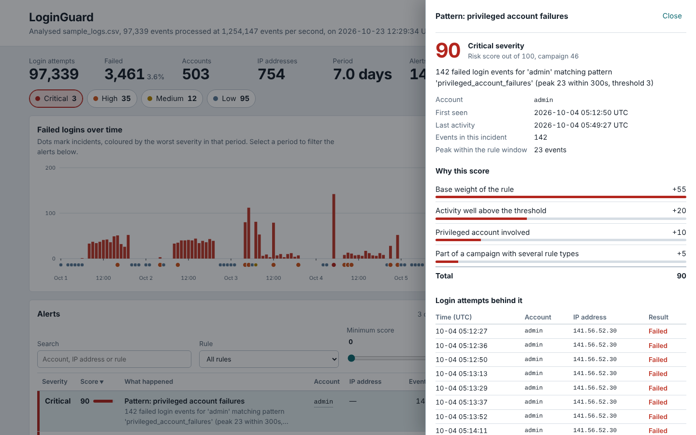
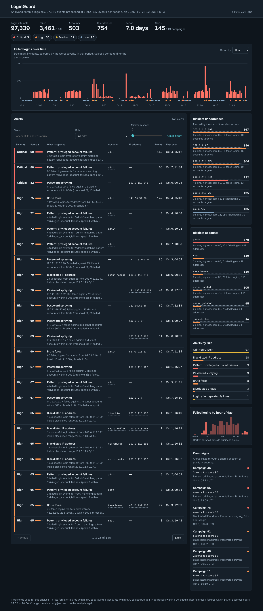

# LoginGuard

Detects brute-force and other suspicious logins in authentication logs, scores and ranks the alerts, and shows them on a web dashboard. C++17, SQLite, a small embedded HTTP server and a dependency-free HTML/JS front end.



| Alert detail | Dark mode | Phone |
| --- | --- | --- |
|  |  |  |

## Quick start

```bash
./run_demo.sh            # Linux/macOS: build, analyse data/sample_logs.csv, serve on http://127.0.0.1:8080
run_demo.bat             # Windows (CMake + Visual Studio or MinGW)
```

Manual build: `cmake -S . -B build && cmake --build build -j && ctest --test-dir build`

If your system has no SQLite development package, the bundled copy (`third_party/sqlite3`) is used automatically (`-DLG_FORCE_VENDORED_SQLITE=ON` forces it).

```
loginguard generate --out data/sample_logs.csv --events 100000 --users 500 --seed 42
loginguard analyze  --logs data/sample_logs.csv --db loginguard.db    # prints recall if a .truth.json sits next to the log
loginguard serve    --db loginguard.db --port 8080
loginguard run      --logs your.csv                                     # analyze + serve
loginguard evaluate --logs data/sample_logs.csv --truth data/sample_logs.truth.json
loginguard bench    --events 1000000
```

Log format: CSV `timestamp,username,ip,status` (status `SUCCESS` / `FAILURE`). Header optional; `#` comments, BOM and CRLF are handled; malformed lines are counted and sampled, never fatal. Times are UTC.

## Architecture

```
 CSV log ──► parser ──► Engine (rules, sliding windows) ──► Scorer (factors, campaigns) ──► SQLite
                                  ▲                                                          │
                       config.json (rules, CIDR blacklist, regex patterns)                   ▼
                                                                          REST API (cpp-httplib) ──► web dashboard
 loggen (synthetic logs + ground-truth labels) ──► evaluate (recall, false alarms)
```

| Module | Role |
|---|---|
| `parser`, `util` | Strict CSV, timestamp (calendar-validated, offsets, epoch) and IPv4/IPv6 parsing |
| `detector` | One streaming pass over time-ordered events; per-key state in hash maps |
| `scorer` | Explainable 0–100 score, severity bands, campaign correlation |
| `storage` | SQLite schema, bulk load in one transaction, indexed filtered queries |
| `api` | JSON endpoints with strict validation and security headers |
| `loggen`, `evaluate` | Reproducible test data with labelled attacks; measures recall |
| `web/` | Dashboard (no external assets, strict CSP) |

## Detection rules

| Rule | Fires when | Keyed by |
|---|---|---|
| `brute_force` | ≥5 failures in 300 s | user + IP |
| `password_spraying` | one IP fails against ≥6 distinct accounts in 600 s | IP |
| `distributed_attack` | one account fails from ≥4 distinct IPs in 600 s | user |
| `success_after_failures` | success after ≥4 failures in 600 s | user + IP |
| `off_hours_login` | success outside business hours | user + IP |
| `blacklisted_ip` | any activity from a CIDR in the blacklist | IP (+user for successes) |
| `custom:<name>` | regex on username + outcome + threshold | user + IP |

A threshold rule opens an incident when it trips, extends it while the pattern continues, and closes it when it stops. A 10-minute attack is **one** alert carrying its peak count and total events, not hundreds.

## Scoring

`score = rule weight + volume + blacklisted_ip + privileged_account + successful_login_from_blacklist + campaign_correlation`, clamped to 0–100. Every point is stored in `score_factors` and shown in the dashboard drawer. Bands: Low <30, Medium ≥30, High ≥60, Critical ≥80. All of it is configurable in `config.json`.

## Data structures and why

| Structure | Used for | Why |
|---|---|---|
| Deque sliding window | failures per key in a time window | O(1) amortised add/expire |
| Deque + hash multiset (`SlidingDistinct`) | distinct users/IPs in a window | O(1) distinct count instead of rescanning |
| `unordered_map` + periodic sweep | per-key state | O(1) lookup; sweep every 65,536 events bounds memory |
| Binary trie | CIDR blacklist, longest-prefix match | O(32) per lookup regardless of list size |
| Union-Find (path compression, union by size) | grouping alerts into campaigns via shared users/public IPs | near-O(1) merges; shared/private IPs and stale links excluded |
| Bounded min-heap | Top-K riskiest IPs/accounts | O(n log k), O(k) memory |
| SQLite indexes + aggregate tables | dashboard queries | filters/sorts stay fast; hourly/IP/user tables precomputed |

## Results

Measured on this build (Linux, Release, single thread):

| Test | Result |
|---|---|
| 984,812 events (51 MB CSV, 5,000 users, 14 days) | parse 630 ms (1.56 M lines/s), detect 149 ms (6.6 M events/s), scoring 2 ms |
| Ground-truth recall, 1 M-event run | 758 / 758 injected attacks (100%), 0 high/critical unrelated alerts |
| Sample dataset (97,339 events) | 145 alerts: 3 critical, 35 high, 12 medium, 95 low; 35/35 attacks found |
| Unit/integration tests | 40 tests, 961 checks (parsers, every rule's boundaries, scoring, storage, SQL-injection strings, HTTP API, 8 seeds end-to-end) |

Remaining "unrelated" alerts are mostly low-severity off-hours logins and a few Medium cases such as a user retrying a mistyped password, which are genuinely ambiguous.

## REST API

`GET /api/health, summary, timeline?bucket=, hour-of-day, alerts, alerts/{id}, rules, top-ips, top-users, top-risk?by=ip|user, campaigns, config`.
`/api/alerts` filters: `severity` (comma list), `rule`, `q`, `min_score`, `max_score`, `from`, `to` (timestamp or date), `cluster`, `user`, `ip`, `sort`, `order`, `limit`, `offset`. Invalid input returns a JSON `400`.

## Security notes

Parameterised SQL only; sort columns whitelisted; `LIKE` wildcards escaped; the dashboard builds the DOM with `textContent` (log content can't inject HTML); CSP `default-src 'none'`, `nosniff`, frame denial; the server binds to `127.0.0.1` unless you pass `--host`.

## Limitations

- Blacklist and campaign IP logic is IPv4 only; IPv6 events are analysed by the other rules.
- Behind a NAT/proxy many users share one IP, which is why private ranges are excluded from campaign linking and why the rules key on user+IP.
- Built-in logs are synthetic; real logs need a column mapping if their format differs.
- Developed and tested on Linux with GCC. Windows and macOS builds are configured in CMake but not tested by me.
- Batch analysis, not a live stream; re-run `analyze` to refresh the database.

## License and third-party code

LoginGuard is released under the MIT License (see `LICENSE`). It bundles cpp-httplib, nlohmann/json and SQLite; see `THIRD_PARTY_NOTICES.md`.
